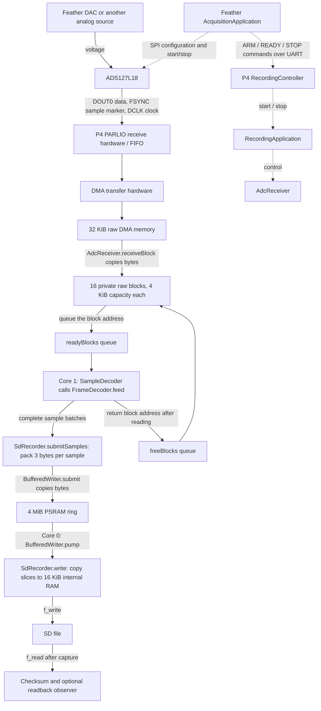

# Recording data flow

The analog input is a voltage. The ADS127L18 converts that voltage into signed
24-bit sample values at the selected rate. Feather configures the ADC over SPI
(a clocked command connection); the sample data travel directly to P4.
The DAC is a test source, not a required part of recording.

## What each step actually does

1. **PARLIO** means parallel input/output. It samples DOUT0 and FSYNC together on
   the ADC clock. Its FIFO is hardware storage preserving incoming order. It is
   not the application's `readyBlocks` queue.
2. **DMA** means direct memory access: hardware writes the packed pin states to
   RAM. DMA is the transfer mechanism, not another software queue. At 1,024,000 samples/second,
   four clock positions occupy one byte and one ADC sample occupies eight raw bytes.
3. The driver's **interrupt service routine (ISR)** calls
   `AdcReceiver::receiveEntry`, which dispatches to `receiveBlock` on
   Core 0. `memcpy` copies each completed DMA chunk into a free private block.
   The hardware can reuse its original DMA memory after this copy.
4. `xQueueSendFromISR` queues the private block's **address**, not its bytes.
   Core 1's `SampleDecoder` takes that address through `AdcReceiver::take`
   (`xQueueReceive`), then `FrameDecoder::feed`
   reads the bytes. The block stays unavailable for reuse until decoding and
   submission finish. `AdcReceiver::release` uses `xQueueSend` to return its
   address to `freeBlocks`.
5. `FrameDecoder` reconstructs the ADC's eight status bits and 24 sample bits.
   It checks framing and status; `SampleDecoder::recordWords` passes batches
   to the application's selected destination.
   Ordinary recording uses `SdCaptureDestination` and `SdRecorder::submitSamples`.
6. `recordingFormat::packSamples` removes the status byte and stores the sample
   as three little-endian bytes. `BufferedWriter::submit` copies those bytes into
   its owned ring. It never performs disk I/O or waits for a disk write. A full
   ring rejects the batch and records a failure.
7. The disk task on Core 0 calls `BufferedWriter::pump`. That calls
   `SdRecorder::write`, which copies slices into internal scratch RAM and calls
   **`f_write` to write the file**. Ring space is released only after that write
   succeeds. A failed or partial write remains an explicit recording failure.

PSRAM is RAM outside the processor chip. The ring wraps back to its beginning,
but cannot overwrite bytes still awaiting a successful write. A task is a
software thread scheduled by FreeRTOS; the disk task and control task share
Core 0, while decoding runs on Core 1. The ISR briefly interrupts Core 0 tasks.

At 1,024,000 samples/second, raw input is 8.192 MB/s and stored samples occupy
3.072 MB/s. Individual stored values range from -8,388,608 to +8,388,607.
Normal SD recording does **no averaging**. The file also has a 512-byte header.

## Stopping and verification

Feather requests ADC stop, then sends P4 STOP. P4 disables reception and places
a null marker behind the queued raw blocks. Core 1 processes those blocks and
signals completion through a semaphore. Only then may Core 0 inspect decoder
state and ask the recorder to finish.

The disk task drains pending bytes, truncates the unused reservation, and uses
**`f_read`** to read the entire stored payload. It compares the readback CRC32
checksum with the checksum accumulated when samples were accepted. It then
writes the final header, synchronizes and closes the file.

- **READY**: receiver setup succeeded; no proof of arriving data.
- **DONE**: reception stopped; the SD file may still be saving.
- **SD SAVED**: the capture checks, disk drain, checksum readback and final file
  operations passed. This does not establish analog accuracy or prove that every
  ADC-generated sample arrived. A final incomplete DMA chunk can be omitted,
  and some hardware losses may escape the available counters.

## Where tests attach

Production startup constructs `RecordingApplication` with `SdCaptureDestination`.
Both startups use `RecordingController` for console/Feather commands and
the `RecordingReporter` interface, with `ConsoleRecordingReporter` for terminal output. Test startup adds `RecordingHarness`, which owns the SD test generator, optional
RAM summary and decoder timings; the profiling build also adds `CaptureProfile`.
The recorder accepts a `RecordingLayout` policy and optional `RecordingReadback`
observer. The normal layout is the ADC file format; the synthetic test supplies
its own known-pattern layout. Neither requires a copied recorder implementation.

For RAM inspection, `RamCaptureDestination` replaces the SD destination before
capture. It summarizes samples and later prints them; it does not save each sample.
For hardware smoke testing, `SdSmokeSummary` observes bytes returned by `f_read`.
The normal full-payload checksum still runs.

See [Recording classes](RECORDING-CLASSES.md) for the control interfaces,
execution contexts and the boundary for replacing Feather's command role.

Feather test startup supplies `BenchAcquisitionServices` to the same
`AcquisitionApplication` used for recording. The service owns `BenchDac` and,
when enabled, `InputSnapshot`. A1's voltage also reaches Feather A2 through the
jumper. A2 observations travel over USB to the PC, independently of the P4 path.
The smoke runner compares those observations with the SD-readback summary.
Neither the A2 observations nor their plot replace full-resolution stored samples.
