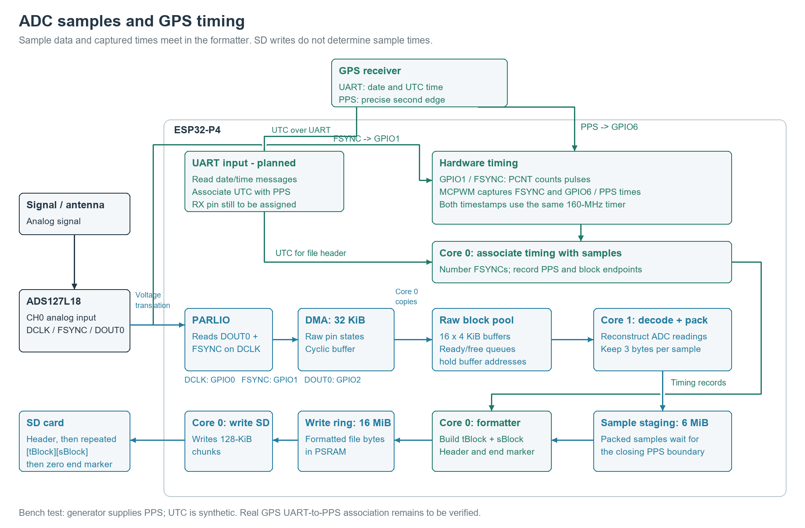
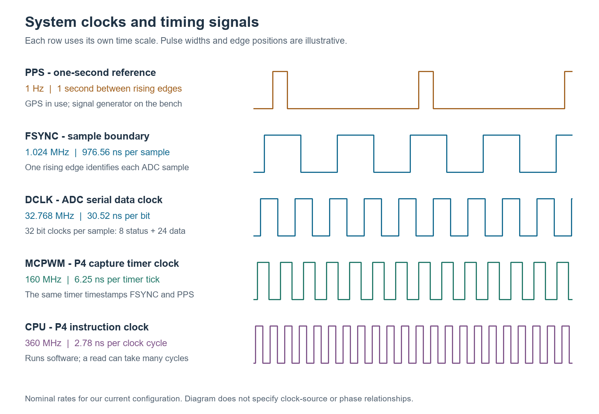
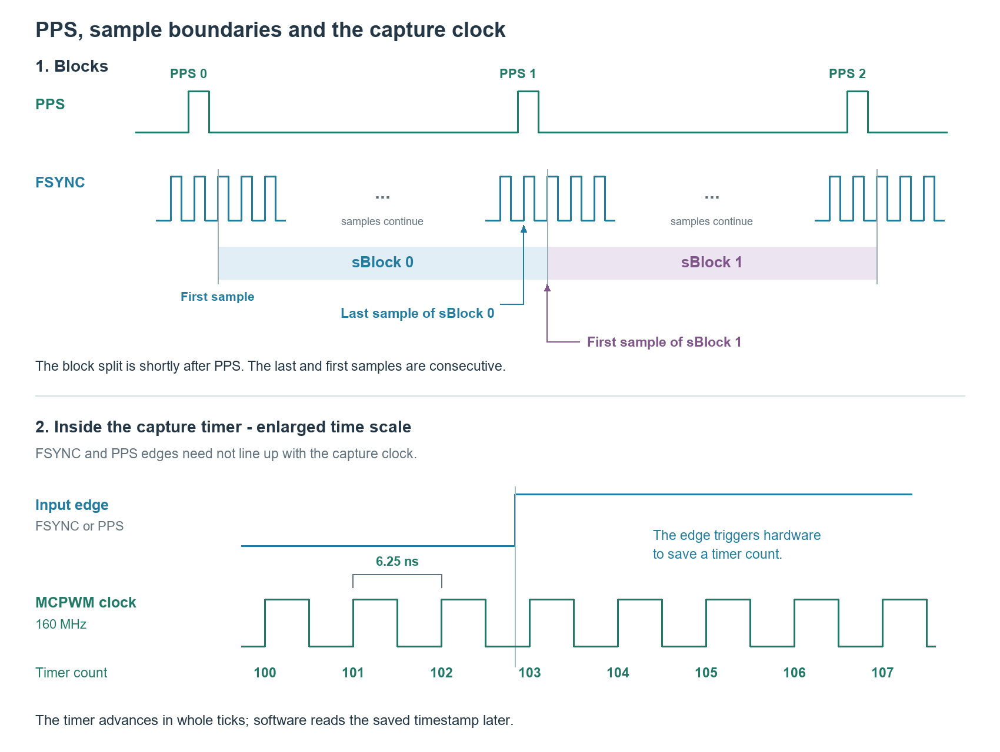

# LxDigitizer: Associating Time with Samples

## Design goals

The LxDigitizer (Lxd) samples a lightning analog signal at 1,024,000 samples per second and writes the results to SD storage. This document describes the method used to associate the time of arrival of a signal with its sample data.

Samples are about 977 ns apart. Simply marking the sample nearest a GPS pulse leaves nearly a microsecond of ambiguity. Instead, Lxd employs a hardware clock on the ESP32-P4 to save the time of the GPS pulse and the time of selected sample boundaries using the same timer. That gives us the offset between the two, with a timer resolution of 6.25 ns. (The same capture feature is available on the S3, but provides a resolution of only 12.5 ns.)

The design has three requirements: keep the timing tied to the correct samples, keep up with the continuous data stream, and stop if sample loss or invalid timing makes that association unreliable.

The combined acquisition, timing and SD-writing path has completed a five-minute bench test with simulated GPS pulses, including four file rotations. All five saved files passed a complete CRC readback check, with no reported sample drops, buffer overflow or storage errors. The remaining work includes connecting actual GPS UTC messages to the correct pulse and establishing an absolute timing error bound.

## Design overview

The ADC is a TI ADS127L18. An ESP32-P4 receives its output through a voltage translator and writes the samples to SD. The GPS supplies a pulse per second, or PPS, and date/time messages through UART.

The ADC supplies an FSYNC pulse for each output frame. Each frame contains eight status bits followed by a 24-bit sample. FSYNC identifies the sample; Lxd does not use the time software finishes receiving or writing it.

The P4's MCPWM peripheral includes a hardware capture timer. Whenever FSYNC or PPS rises, hardware saves that timer's tick count. The two signals use separate capture channels on the **same 160-MHz timer**. Software reads the saved counts later.

Lxd then has two jobs:

- Associate an FSYNC tick count with a particular sample number.
- Associate a PPS tick count with a particular UTC second.

Once those associations are established, subtraction gives the offset between a sample's FSYNC and PPS. 
offsetNs is the sample’s FSYNC time relative to the opening PPS, in nanoseconds, before subtracting the ADC delay. The following section already contains the complete calculation.

```python

dtcPps = tcPpsNext - tcPpsCurrent
offsetNs = (tcSample - tcPpsCurrent) * Fraction(1_000_000_000, dtcPps)

```

The number of timer ticks between successive PPS pulses tells us how to convert that offset to seconds. Lxd does not assume the timer runs at exactly 160 MHz.

There is also a delay through the ADC and voltage translator. Calibration established this delay at **2,553 ns.**

```python
# Both times are expressed in nanoseconds.
timeOfArrivalAtADC = timeOfArrivalAtP4 - 2553
```



## Calculating a sample's time

Lxd saves consecutive samples in **tBlock** and **sBlock** pairs. Each pair corresponds to one PPS interval. The tBlock contains:

| Field | What it supplies |
| --- | --- |
| `tcFsFirst`, `tcFsLast` | FSYNC tick counts for the first and last samples |
| `tcPpsCurrent`, `tcPpsNext` | Tick counts for consecutive PPS pulses |
| `sCount` | Number of samples in the sBlock |
| `nSec` | Whole-second offset from the file's UTC starting time |

The file header supplies `utcFirst`, the UTC second of the first opening PPS, and `delayNs`, the calibrated delay correction.

For sample index `iSample`, starting at zero, the following Python code calculates `tSample`, the analog input time.

```python
from fractions import Fraction

# Average tick spacing between samples. Keep the division exact.
dtcSample = Fraction(tcFsLast - tcFsFirst, sCount - 1)

# FSYNC tick count for the desired sample.
tcSample = tcFsFirst + iSample * dtcSample

# Measured ticks per PPS interval, nominally 160 million.
dtcPps = tcPpsNext - tcPpsCurrent

# FSYNC time in UTC seconds. Fraction arithmetic preserves precision.
tFs = utcFirst + nSec + (tcSample - tcPpsCurrent) / dtcPps

# Estimated analog-input time, in nanoseconds since January 1, 1970.
tSample = tFs * 1_000_000_000 - delayNs
```

`tSample` is in nanoseconds and may include a fraction of a nanosecond. If a whole-number result is needed, use `round(tSample)` at the end. Exact arithmetic avoids numerical rounding loss; it does not imply that the physical timing is known to that precision.

The calculation uses the measured sample spacing and PPS interval. It corrects average clock rates over the block; it does not correct individual clock jitter or changes of rate within that interval.

## What has been established

The useful results are as follows:

| Contention | Evidence |
| --- | --- |
| Lxd can connect FSYNC counts to samples. | The five-minute run passed startup and stopped-counter checks. All 192,011 usable pulse-number comparisons agreed. The longest observation gap was 1.163 ms, below the 10-ms limit. |
| Lxd can retain PPS timing while acquiring and writing. | All 300 simulated PPS pulses and sample-block boundaries were accounted for. No missing or invalid PPS intervals were reported. |
| The SD writer kept up through file rotation. | The run retained 306,174,907 samples in 299 complete intervals across five files, with no reported sample drops, buffer overflow or storage errors. All 918,540,593 saved bytes passed CRC readback. |
| The existing buffer absorbed write delays. | Peak ring usage was 4.18 MiB of 16 MiB. The longest measured write operation took 298 ms. No buffer enlargement was needed. |
| Timing survives counter wraparound. | The hardware timer wrapped eleven times during that run; the extended timestamps remained consistent. |
| Tests measured the delay correction. | Pulse-delay measurements, corrected for the measured difference between the two P4 input paths, gave the adopted 2,553-ns correction. Tests near 1 kHz and at 10 kHz gave similar delay results. |

These results support the sample association and recording method using a signal generator instead of a GPS unit to supply PPS. The five-minute run saved 299 complete PPS intervals; partial intervals at startup and shutdown were omitted as designed.

The measured difference between the P4 FSYNC and PPS input paths was about 3 ns on rising edges. This does not measure delay common to both. Likewise, 6.25 ns is the timer's tick interval, not a demonstrated total uncertainty.

Detailed measurements are contained in separate documents. 

## Binary file structure

```text
[256-byte header]
[tBlock 0][sBlock 0]
[tBlock 1][sBlock 1]
...
[48-byte zero end marker]
```

Each tBlock is 48 bytes. Each sample is a signed 24-bit value stored in three bytes, with no status byte or embedded timing bit. An sBlock therefore occupies exactly `3 * sCount` bytes.

A reader needs only the header and one tBlock to calculate times for that sBlock. It reads `sCount` samples, then advances to the next tBlock. The zero end marker is recognized only where a tBlock belongs; zero-valued samples are ordinary data.

Within a tBlock, `tcPpsNext - tcPpsCurrent` is approximately 160 million ticks. Between adjacent tBlocks, the earlier block's `tcPpsNext` equals the following block's `tcPpsCurrent`. The FSYNC endpoints belong to different, consecutive samples.

The default is 60 pairs per file and ten circularly reused file slots. Both are configurable. A new file gets its own UTC starting time and begins with `nSec = 0`. Only complete intervals are saved, so startup and shutdown partial intervals are omitted.

## Implementation details

### Clocks and connections



The ADC's 32.768-MHz DCLK supplies 32 clocks per frame, giving 1.024 million samples per second. FSYNC and DCLK are related. The capture timer and GPS pulses are not synchronized to those sample boundaries. The P4 CPU runs at 360 MHz; that determines software execution speed, not timestamp resolution.

| Signal | P4 connection | Purpose |
| --- | --- | --- |
| ADC DCLK, through voltage translator | GPIO0 | Clock for receiving serial sample bits |
| ADC FSYNC, through voltage translator | GPIO1 | Identifies sample frames; supplies pulse counting and timestamp capture |
| ADC DOUT0, through voltage translator | GPIO2 | Carries CH0 sample data and status bits |
| GPS PPS | GPIO6 | Supplies the one-second timing reference |
| GPS serial output | UART receive input; pin to be assigned | Supplies UTC date and time |

### Establishing sample zero

Acquisition starts with the ADC stopped while the P4 prepares the receiver and resets the counters. In the observed startup sequence, the first captured frame contains 31 clocks instead of 32. Lxd discards that first frame:

```text
FSYNC pulse 1 -> discarded startup frame
FSYNC pulse 2 -> sample 0
FSYNC pulse 3 -> sample 1
sample index = FSYNC pulse number - 2
```

Numbering continues throughout acquisition, across file changes. Sample zero is not necessarily the first sample saved; recording waits for a complete PPS interval.

### Associating FSYNC pulse numbers with tick counts

GPIO1 feeds two hardware peripherals:

- **PCNT** counts FSYNC rising edges.
- **MCPWM** saves the timer tick count of the latest FSYNC rising edge.

Together, these need to tell Lxd: **“FSYNC pulse N occurred at tick count T.”** However, the values occupy separate registers. An FSYNC edge can occur between software reads, leaving a pulse number and tick count that belong to different edges.

**At startup**

Core 0 reads:
```text
pulse count → tick count → pulse count again → tick count again
```

The two pulse counts must agree, and the two tick counts must agree. The reads must also pass timing checks: the sequence must take less than one sample period, and the information used to extend the hardware pulse counter must be no more than 100 µs old.

If these checks fail, Lxd tries again on the next observation, roughly 1 ms later. The first usable pair establishes the starting reference.

**Throughout acquisition**

Core 0 continues the same four-read sequence roughly every millisecond. Each observation serves two purposes:

1. **Predict the current pulse number from elapsed ticks.**
2. **Check that prediction against PCNT whenever the four reads pass the consistency and timing checks.**

The prediction uses the previous numbered FSYNC timestamp:

```text
deltaTicks = currentTicks - previousTicks
deltaPulses = round(deltaTicks / 156.25)
predictedPulse = previousPulse + deltaPulses
```

The nominal ratio is 156.25 timer ticks per sample. For example, if 160,000 ticks have elapsed since pulse 1,000, the predicted pulse number is 2,024.

If the usable PCNT count disagrees with the prediction, Lxd faults and stops. If the four reads are unusable, Lxd skips that comparison. It can still advance the prediction using the captured FSYNC tick count. It does not reset the prediction to make it agree with PCNT.

Each observation advances the working reference for the next observation. Frequent observations limit how much relative clock drift can accumulate before rounding the elapsed ticks to a whole number of pulses. Lxd stops if the observation gap exceeds 10 ms or the calculated pulse increment is 0.25 or more away from a whole number.

**How this supplies tBlock data**

These millisecond observations maintain a recent association between an FSYNC pulse number and its tick count. **They do not create tBlocks.**

When PPS arrives, Lxd uses that recent reference to number the FSYNC pulses selected as the sBlock boundary. Pulse numbers identify the corresponding samples; captured tick counts provide their timing.

Once the next boundary and all intervening samples are available, Lxd has the information needed for one tBlock/sBlock pair.

The repeated reads are software checks, not an atomic hardware capture of both values. Startup framing, ongoing PCNT comparisons, and a final counter check after stopping provide additional verification.

### Choosing the boundary after PPS

MCPWM saves the tick count when PPS rises. The interrupt handler copies that saved value. Software on Core 0 then looks for two consecutive captured FSYNC timestamps, separated by 156 or 157 ticks.

The earlier pulse identifies the last sample of the old sBlock. The later pulse identifies the first sample of the new one. Their sample numbers come from the recent numbered FSYNC reference.



The split is shortly after PPS, not necessarily at the first sample after it. This does not add software response time to the timestamp: Lxd retains the actual captured PPS and FSYNC counts and use their difference. No sample is duplicated or omitted between complete blocks.

The search permits up to 32 further reads after its initial capture-register read and must finish in less than 20 microseconds. The numbered reference and the resulting boundary relative to PPS must satisfy the 10-ms limits. Failure to establish a valid boundary stops recording.

The first sample of the new block and the last sample at the following boundary supply `tcFsFirst` and `tcFsLast`. Subtracting successive first-sample numbers gives `sCount`. Software waits for both boundaries and all intervening samples before submitting the pair for writing.

### Keeping up with the input

The sample payload is about 3 MB/s. Core 1 decodes and packs the samples; Core 0 handles timing, file formatting and SD writes. Samples wait in a 6-MiB staging buffer until their complete interval is available. The formatter then submits the tBlock/sBlock pair to a separate 16-MiB write ring. SD writes use 128-KiB chunks, independently of the logical block boundaries.

The important performance changes were placing the time-critical capture and decoder routines in internal instruction RAM, using an internal DMA-capable SD transfer buffer, and separating formatting from disk writing. In the tested configuration, the control/timing task has priority 5, above the writer at 4 and formatter at 3; the decoder runs on Core 1 at priority 10. The control loop sleeps for one scheduler tick between passes, allowing storage work to proceed.

The 16-KiB transfer buffer follows each file's position, independently of the ring's 128-KiB chunks. Full writes start at aligned 16-KiB file offsets. At file close, the remaining bytes are written without padding, and the next file starts with an empty transfer buffer. This removed the sustained slowdown observed after rotation. The five-minute test passed without enlarging the ring or relaxing the timing checks.

Temporary SD delays are absorbed by buffering. They do not change the stored tick counts. If incoming samples cannot be retained, recording faults and stops rather than silently losing data.

### Wraparound and missing pulses

The 32-bit hardware timer wraps about every 26.84 seconds. Frequent FSYNC observations extend the counts to 64 bits, and PPS timestamps are placed on that same timeline. The file stores the extended counts.

PPS intervals must be between 158,400,000 and 161,600,000 ticks, approximately 0.99 to 1.01 seconds. A missing pulse is declared after 176,000,000 ticks, approximately 1.1 seconds. These numbers are thresholds allowing 1% variation of a 160MHz clock.

## Binary-layout reference

All multibyte values are little-endian. Fields are written explicitly; compiler padding is not stored. Offsets below are relative to the beginning of the header or tBlock.

### File header: 256 bytes

| Offset | Bytes | Field | Meaning |
| ---: | ---: | --- | --- |
| 0 | 4 | `fileId` | The four characters `LXDG`, identifying this file format |
| 4 | 2 | `version` | Format version; currently 1 |
| 6 | 8 | `utcFirst` | UTC time of the opening PPS for the first sBlock, expressed as whole seconds since January 1, 1970 |
| 14 | 4 | `delayNs` | Delay correction subtracted from sample FSYNC times; currently 2,553 ns |
| 18 | 4 | `blockPairsPerFile` | Maximum number of tBlock/sBlock pairs in this file; default 60 |
| 22 | 234 | Reserved | Set to zero; available for future format additions |

`blockPairsPerFile` is the configured limit, not the number actually written. A normal stop can leave fewer pairs in the last file. `utcFirst` is an unsigned 64-bit integer; `delayNs` is signed 32-bit. Version is unsigned 16-bit and the pair limit unsigned 32-bit.

### tBlock: 48 bytes

| Offset | Bytes | Field | Meaning |
| ---: | ---: | --- | --- |
| 0 | 8 | `tcFsFirst` | FSYNC tick count for the first sample in the sBlock |
| 8 | 8 | `tcFsLast` | FSYNC tick count for the last sample in the sBlock |
| 16 | 8 | `tcPpsCurrent` | PPS tick count for this block |
| 24 | 8 | `tcPpsNext` | PPS tick count for the next tBlock |
| 32 | 4 | `sCount` | Number of samples in the following sBlock |
| 36 | 2 | `nSec` | Whole seconds from the file’s `utcFirst` to this block’s opening PPS |
| 38 | 10 | Reserved | Set to zero |

Tick counts are unsigned 64-bit integers, `sCount` is unsigned 32-bit, and `nSec` is unsigned 16-bit. The file ends with an all-zero 48-byte record at the next tBlock position.

Detailed file specs are contained in a separate document.
