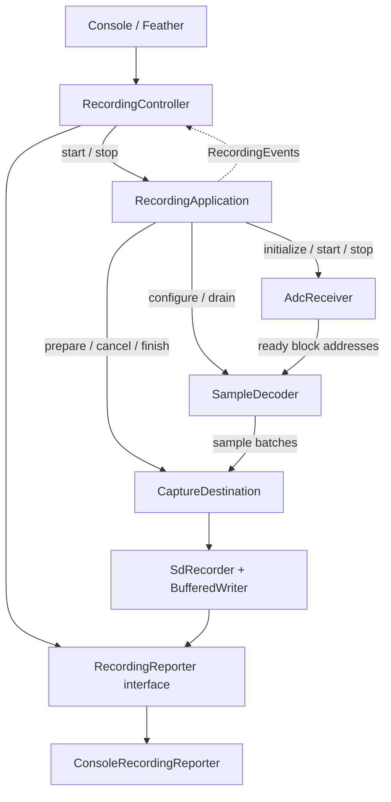

# P4 recording classes

Start with `espP4/main/src/main.cpp`. It constructs the services, initializes
them, then repeatedly calls the controller and application. Power-up alone
does not start a recording.

| Class | Responsibility | Where it executes |
| --- | --- | --- |
| `RecordingController` | Interpret console/Feather commands; send required Feather replies | Core 0 control task |
| `RecordingApplication` | Enforce preparation/start/stop sequencing and deadlines | Core 0 control task |
| `AdcReceiver` | Configure receive hardware; copy raw bytes into private blocks; own free/ready queues | Setup/stop on Core 0; copying in Core 0 interrupt |
| `SampleDecoder` | Take ready blocks, decode their contents, submit samples, release blocks | Core 1 decoder task |
| `FrameDecoder` | Reconstruct sample words and check framing/status | Called by `SampleDecoder` on Core 1 |
| `SdCaptureDestination` | Adapt sample submission and recording operations to `SdRecorder` | Control on Core 0; submission on Core 1 |
| `SdRecorder` | Own card/file operations and the buffered writer | Disk operations on Core 0 SD task; submission on Core 1 |
| `BufferedWriter` | Hold queued bytes until their storage write completes | Submission on Core 1; draining on Core 0 |
| `RecordingReporter` | Interface receiving status and result events | Core 0 control or SD task |
| `ConsoleRecordingReporter` | Format those events for the USB terminal | Core 0 control or SD task |

A task is a software thread. The control and SD tasks take turns on Core 0.
The interrupt callback briefly interrupts ordinary Core 0 execution; it never
prints, decodes samples or writes the card. Core 1 runs decoding independently.

## Follow one recording

1. At boot, `SdRecorder::initTask()` allocates buffers and creates the disk task.
   It does not open a recording file or establish that a card is present.
2. Feather sends `ARM3` with a run ID and actual samples/second. P4 resolves the
   rate to an `Ads127Config`; unknown rates are refused. The controller calls
   `start(run, adsConfig)`, which requests `prepare(run, adsConfig)` on the destination. There is no separate `p` command
   or `claim()` operation. Acceptance means preparation is pending, not complete.
3. `poll()` waits for storage readiness, then configures decoding and reception.
   Successful receiver setup sends a ready event; the controller sends `READY3`.
   Only then does Feather start ADC sampling. SD preparation may take up to
   180 seconds; Feather waits up to 185 seconds. Recording timers start after
   receiver setup, so preparation does not consume the requested recording time.
   Preparation failure, timeout or cancellation prevents reception, including
   when a slow disk operation eventually completes.
4. Hardware and the receiver callback deliver raw blocks. The decoder task
   reads them and submits samples. The SD task writes queued bytes. Neither
   the controller nor `RecordingApplication::poll()` moves samples.
5. `poll()` checks receive/storage faults, the deadline and a full RAM
   destination. Full RAM produces a `RecordingEvents::destinationFull` callback;
   today's controller sends `RAMFULL`. Missing acknowledgement after two seconds
   ends the receiver run as a fault.
6. Feather sends `STOP`. The controller calls `stop()`. The application disables
   reception, waits for queued decoding, takes a stable result snapshot, notifies
   the controller, then asks the destination to finish.
7. The controller sends `DONE`, `FAULT` or `TIMEOUT`. Optional diagnostics follow.
   SD draining, readback and close are separate work; `SD SAVED` is the later
   storage outcome. Receiver inactivity alone does not mean the file is saved.

Repeated matching requests return `alreadyPreparing` or `alreadyRunning` without
repeating setup or extending either deadline. A different pending/active request
returns `busy`. Cancellation asks the disk task to close its unused file; a new
request is refused until cleanup finishes. Cancellation never deletes that file.
A failed decoder drain is fatal: the application does not reuse memory while
Core 1 might still be modifying it.

## Configuration and reporting

`common/Ads127Config.h` contains the complete supported ADC configurations.
`adsConfig` names the default: 1,024,000 samples/second. It refers to a named
configuration, not an array position. Feather's `g` command requests it; `6`
remains a keyboard alias. Keys `0` through `5` select lower rates explicitly.
Applications and drivers accept the struct by const reference, copying it when
needed after the call returns. The two register codes configure the ADC on
Feather; P4 uses the rate and output-word spacing to configure reception.

ARM3/READY3 carry the actual sampling rate, never a table index. Both boards
must have matching configuration definitions. If multiple configurations ever
share a rate, this protocol must be extended to distinguish their settings.
Old ARM2/READY2 requests are not accepted as new requests. Rebuild and upload
both boards together. Neither board starts sampling merely because it boots.

`SdRecorder` remains independent of ADC register settings. Its adapter passes
only run ID and samples/second. The former stage field at SD header offset 20
is reserved and written as zero; the payload and all other offsets are unchanged.
Readers ignore that field, including nonzero values in historical recordings.

`RecordingReporter` is now an interface. `ConsoleRecordingReporter` contains
the existing terminal formatting and `printf` calls. Startup supplies the concrete
reporter to the controller and recorder. A future C6 implementation can send
structured events without changing recording logic; no C6 transport is implemented
yet. Such a sender must copy borrowed arguments before queuing asynchronous work.
Required Feather control replies remain in `RecordingController`.

## Replacing Feather

Replace the controller/startup wiring. The application has no console reads,
UART driver calls, Feather command strings or terminal formatting. It exposes
`initialize`, `start`, `stop`, `poll` and `getRecordingState` operations.
`RecordingState` describes receiver/control state, not asynchronous SD readiness.
The destination decides whether it can accept preparation for a new run.
`_recordingDestinationLocked` fixes SD/RAM selection until reset, even after a
failed preparation. It is a selection flag, not a mutex or thread lock.

`RecordingEvents` carries required source-control notifications and completed
results back to the controller. Calls occur synchronously on Core 0; recipients
must not call recording operations recursively. A future network/display
implementation should queue slow work rather than block these callbacks.
Replacing the controller does not by itself replace Feather's ADC configuration,
ADC start/stop or test-voltage responsibilities.

## Tests and folders

Test startup supplies `RecordingHarness` through two distinct interfaces:
`RecordingConsoleCommands` for extra keys, and `RecordingObserver` for lifecycle
and timing measurements. The observer no longer handles commands. RAM capture,
SD generated-data tests and profiling remain under `espP4/test`.

`BufferedWriter` and its independent checks are under `espP4/lib/bufferedWriter`.
It remains reusable without ADC, board-control or filesystem dependencies.
`common` holds only definitions used by both board projects: sampling rates,
line assembly, preparation timeouts and test timing. Feather-only pins and web headers live with Feather.

The PC smoke runner includes `recordingControlChecks.cpp`, which exercises the
real application with injected receiver/decoder/storage outcomes and a simulated
clock. It checks preparation, repeated commands, shutdown order and failures.
It does not test actual interrupts or scheduling. Firmware builds and the
hardware smoke test are still required after this refactor.
