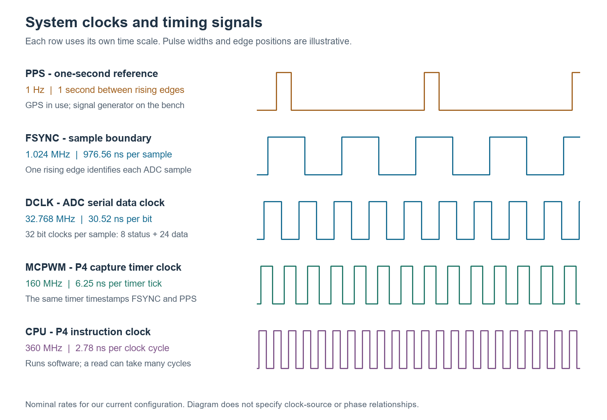
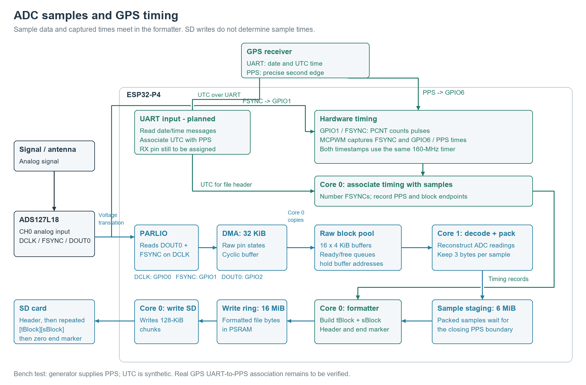
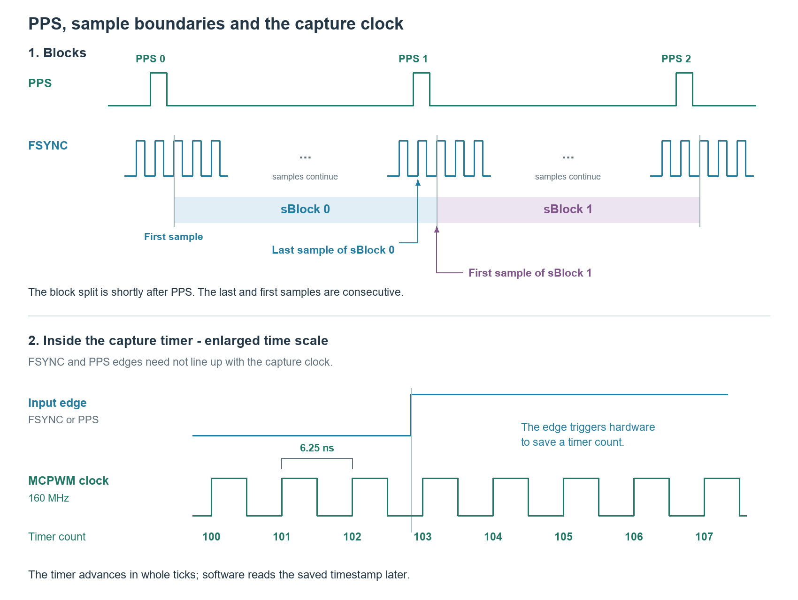

# Sample timing design: FSYNC, PPS and recorded time

Design and implementation as of November 7, 2026.

## Purpose and present status

For every saved CH0 reading, recover an estimated time at the analog input.
The ADC delivers a sample later than the input signal it represents. We measure
when its corresponding FSYNC occurs, relate that time to PPS, then subtract
the accepted 2553-ns path delay.

The implementation has passed a 60-second test with a signal generator supplying
PPS while the ADC runs and the P4 writes the new file format to SD. Real GPS
association with UTC has not yet been implemented and verified in this path.
The test header uses a synthetic UTC origin. Thus the working result is sample
timing relative to the supplied PPS, with the machinery for absolute UTC ready
to receive a verified UTC origin.

This document explains the design rather than the debugging history. See
[the November 7 record](2026-11-07-TIMING-AND-RECORDING.md) for performance fixes
and [the format specification](TIMED-FILE-FORMAT.md) for the maintained binary
layout. The accuracy evidence is summarized here so these distinctions remain
visible when using the time formula.

## 1. What is measured

| Term | Meaning in this project |
| --- | --- |
| Sample | One CH0 ADC result, stored as a signed three-byte number |
| FSYNC | Signal identifying the ADC output frame containing that sample |
| Rising edge | A signal's transition from low to high |
| PPS | One pulse per second; its rising edge supplies the second reference |
| Tick count | A reading of the P4 capture timer; not a sample count or a UTC second |
| Pulse count | Number of FSYNC rising edges since acquisition was armed |
| sBlock | Consecutive retained samples associated with one PPS interval |
| tBlock | Metadata immediately before its sBlock, sufficient to calculate sample times |
| Chunk | A 128-KiB unit of buffered SD writing; independent of tBlock/sBlock boundaries |

The ADC supplies nominally 1,024,000 samples/second: 976.5625 ns per sample.
The capture timer runs nominally at 160 MHz: 6.25 ns/tick, or 156.25 ticks per
sample. The CPU runs at 360 MHz; its instruction timing is not the sample clock.



Each row uses its own time scale. DCLK and FSYNC are related: 32 DCLK cycles
make one normal sample frame. The 160-MHz timer timestamps both FSYNC and PPS;
the CPU clock determines how fast software runs, not the timestamp resolution.
The [SVG original](images/system-clocks.svg) is retained for editing and printing.

### Data and timing paths



Blue arrows carry sample or file data; green arrows carry timing information.
The 32-KiB DMA area and sixteen 4-KiB raw-data buffers are separate storage.
Ready/free queues hold buffer addresses, not extra copies of their contents.
Core 1 decodes samples; Core 0 handles timing, formatting and disk writes.
The 6-MiB staging area waits for complete intervals before the formatter adds
tBlocks and submits file bytes to the 16-MiB write ring.
GPS UART association is shown as the planned input; the passing bench test
used generator PPS and synthetic UTC. Control wiring and power are omitted.
The [SVG original](images/sample-data-flow.svg) is retained with the diagram.

```text
CH0 analog signal -> ADC/filter -> serial sample data -> P4 decoder -> saved samples
                          |
                          +-> FSYNC -> voltage translator -> GPIO1 capture

GPS PPS (generator in bench test) -----------------------> GPIO6 capture

GPIO1 and GPIO6 captures use the same timer.
```

FSYNC arrival at the P4 is the timing reference for a decoded sample. It is
not the time the last serial bit is received, a DMA buffer is decoded, or an
SD write completes. DMA is the hardware transfer of received data into memory.
Those later operations can be delayed without changing the captured time,
provided they preserve the sample order and lose no data.

## 2. Associating a captured FSYNC with a decoded sample

### Startup establishes the sample-number convention

Acquisition starts with the ADC stopped and the counters reset. The first
captured frame is incomplete in the observed startup: 31 clocks rather than
the normal 32. The timing path explicitly discards that first frame, accepting
the checked 31/32-clock startup convention. Subsequent framing must be normal.

```text
FSYNC pulse 1 -> discarded startup frame
FSYNC pulse 2 -> decoded sample 0
FSYNC pulse 3 -> decoded sample 1
...
sample index = FSYNC pulse number - 2
```

These are acquisition-wide indices. The first sample eventually retained in
the file is usually later than acquisition sample zero, because recording
waits for a complete PPS interval. The file does not need to store these indices.

### Two hardware peripherals provide the observations

PCNT, the hardware pulse counter, counts FSYNC rising edges. MCPWM, a peripheral
used here for its capture function, saves a timer value on each FSYNC rising
edge. Both see GPIO1, but their registers are separate: they are **not an
atomic count-and-time pair**.

For the initial reference, software reads count/time/count/time in a short
protected section. It accepts a reference only when both repeated values agree,
the measured read bracket is shorter than the configured sample-period limit,
and the counter-extension reference is fresh. The PCNT driver extends its
32767-pulse hardware wraps. This supplies an initial numbered timestamp.
It is a screened software observation, not a hardware-latched joint snapshot.

### Frequent observations maintain numbering

The current implementation observes FSYNC roughly every millisecond, not just
once per PPS. From the previous numbered capture it computes:

```text
deltaTicks  = current captured ticks - previous captured ticks
deltaPulses = nearest integer to deltaTicks / 156.25
current pulse number = previous pulse number + deltaPulses
```

The integer implementation uses `(4 * deltaTicks + 312) / 625`, with integer
division, to represent the nominal 156.25-tick period without a floating-point
division. It does not extrapolate a nominal sample rate for an entire recording.
Each accepted observation becomes the next reference.

The running predictor stops if the observation gap exceeds 10 ms or its
rounding residual reaches 0.25 sample. The residual is the distance between
`deltaTicks / 156.25` and the chosen whole number of periods. This guard leaves
margin to the half-sample rounding boundary; it is not a measured UTC error.

Whenever the independent PCNT reference is usable, software compares it with
the predicted number. It records disagreement rather than silently resetting
the predictor to make the numbers match. Once the ADC stops, the settled
counter/timestamp provides another check of the final absolute pulse number.
Startup framing and retained sample references are also checked.

This method has produced matching checks and zero stopped-endpoint error in
the passing tests. It does not turn the two peripherals into an atomic pair,
and the tests are not a proof for every possible hardware or scheduling fault.
No one-sample error was observed in the final passing run; a hypothetical
976.56-ns error is not part of a measured uncertainty budget.

## 3. Relating samples to PPS and choosing block boundaries

GPIO6 uses another capture channel on the same timer. On PPS, hardware saves
the tick count. The interrupt handler copies that saved value for later use;
software's response latency is not substituted for the edge time.

Later, control code uses a recent numbered FSYNC reference and captures an
actual adjacent pair of FSYNC edges shortly after PPS. Their spacing must be
156 or 157 ticks. If a read skips an edge, the newer capture becomes the next
candidate. The bounded search allows 32 reads and rejects a duration of
20 microseconds or more. It runs in internal instruction RAM with ordinary
local interrupts excluded during the short search. DMA and the other core
continue. There is no interrupt on every FSYNC.

The pair is numbered from the recent reference, with a maximum 10-ms age and
the rounding guard. The resulting boundary must also be within 10 ms after
its PPS. These are rejection conditions, not guarantees that execution can
never stall.

For boundary `k`, define:

- `P[k]`: actual captured PPS tick count.
- `L[k]`: earlier FSYNC of the adjacent pair; ends the previous sBlock.
- `F[k]`: later FSYNC of the pair; starts the next sBlock.
- `S[k]`: acquisition sample index of `F[k]`.



Pulse spacing is illustrative; most FSYNC pulses are omitted. At the boundary
following PPS 1, the label "Last sample of sBlock 0" is L[1]; the label
"First sample of sBlock 1" is F[1]. Each colored bar ends where the next block begins; its last sample
is the FSYNC edge immediately before that dividing line.
The lower panel has a separate, enlarged time scale. The timer advances in
whole 6.25-ns ticks; an external edge need not coincide with a tick. The numbers
100 through 107 are illustrative. No particular number is identified as the
captured result: the diagram does not assert a next-clock-edge capture delay.
Espressif documents that the input event saves the timer count, but the
[capture API description](https://docs.espressif.com/projects/esp-idf/en/v5.5/esp32p4/api-reference/peripherals/mcpwm.html#capture)
does not establish that exact input-to-capture latency. Software subsequently
reads the saved timestamp; its read time is not used as the timestamp.
The [SVG original](images/pps-fsync-blocks.svg) is retained for editing and printing.

The split is shortly **after** PPS, not necessarily at the first sample after
PPS. The last sample of a block can follow its closing PPS. This is deliberate:
we keep actual endpoint captures rather than inventing an unobserved predecessor.
There is no duplicate or omitted sample between complete sBlocks.

The formatter constructs the tBlock as follows:

```text
tcFsFirst  = F[k]
tcFsLast   = L[k+1]
tcPpsFirst = P[k]
tcPpsLast  = P[k+1]
sCount     = S[k+1] - S[k]
nSec       = interval number within this file, starting at 0
```

An interval is not submitted until both boundaries and all its samples are
available. Samples wait in 6 MiB of staging memory. Complete intervals pass
through the formatter into the separate 16-MiB write ring; the disk task drains
that ring. Consequently SD stalls do not alter the saved timing metadata.
If the buffers cannot keep up, recording fails rather than silently overwriting.

The timer's raw 32-bit count wraps about every 26.84 seconds. Frequent FSYNC
observations extend it into 64-bit counts; nearby PPS and boundary captures
are placed on that same extended timeline. Two wraps were exercised in the
final test. The origin is arbitrary: subtracting tick counts removes it.

The present bench checks reject PPS intervals outside 158,400,000–161,600,000
ticks and flag a missing pulse after 176,000,000 ticks (nominally 1.1 s).
These detect gross faults; they are not GPS accuracy specifications or lock
checks. Real UTC-message association with the correct PPS remains to be verified.

## 4. Binary file structure

```text
256-byte header
48-byte tBlock 0 | 3 * sCount[0] sample bytes
48-byte tBlock 1 | 3 * sCount[1] sample bytes
...
48 zero bytes: normal end marker
unused preallocated tail, if any
```

All integers are little-endian. Fields are serialized explicitly; compiler
structure padding is not written. Samples contain no embedded timing bits.

### Header

| Offset | Bytes | Field | Meaning |
| ---: | ---: | --- | --- |
| 0 | 2 | `fileId` | ASCII `DG` |
| 2 | 2 | `version` | Unsigned integer 1 |
| 4 | 8 | `utcFirst` | UTC seconds since 1970 for the first retained opening PPS |
| 12 | 4 | `delayNs` | Signed input-to-FSYNC correction; currently 2553, reader rejects negatives |
| 16 | 4 | `pairsPerFile` | Maximum complete pairs; default 60 |
| 20 | 236 | Reserved | Zero |

The header is written once, without a shutdown rewrite. `utcFirst` is not the
time acquisition or disk allocation began. The bench uses `946684800`, meaning
2000-01-01, as a synthetic origin. The file has no GPS-validity/source flag;
a plausible timestamp alone cannot establish that the origin came from GPS.

### tBlock

| Offset | Bytes | Field | Meaning |
| ---: | ---: | --- | --- |
| 0 | 8 | `tcFsFirst` | Extended captured ticks of first sample in following sBlock |
| 8 | 8 | `tcFsLast` | Extended captured ticks of last sample in following sBlock |
| 16 | 8 | `tcPpsFirst` | Extended ticks of opening PPS reference |
| 24 | 8 | `tcPpsLast` | Extended ticks of closing PPS reference |
| 32 | 4 | `sCount` | Number of samples that immediately follow |
| 36 | 2 | `nSec` | Whole-second offset from this file's `utcFirst` |
| 38 | 10 | Reserved | Zero |

Tick fields are unsigned 64-bit integers; `sCount` is unsigned 32-bit and
`nSec` unsigned 16-bit. `nSec` is not a tick count. `sCount` need not be exactly
1,024,000: source clocks and boundary placement can vary.

Adjacent tBlocks share a PPS value: the earlier `tcPpsLast` equals the next
`tcPpsFirst`. They do **not** share an FSYNC endpoint: the earlier `tcFsLast`
belongs to the sample just before the next `tcFsFirst`.

There is no stored sample index, `dtcSample`, `bValid`, or per-block checksum.
The first/last ticks and count provide the sample spacing on readback. Both
PPS ticks are present so one block can be interpreted without reading the next.

### sBlock, completion and file rotation

An sBlock contains `sCount` signed 24-bit readings, low byte first, with no
ADC status byte. Examples: `FF FF FF` is -1; `00 00 80` is -8,388,608.

An all-zero 48-byte record is an end marker **only at a tBlock position**.
Zero samples remain ordinary data. Readers advance by exactly `3 * sCount`
bytes and never scan sample bytes for markers. The marker denotes normal
completion, not protection against arbitrary corruption or interrupted power.

Defaults are 60 pairs per file and ten circularly reused file slots. At file
rotation, `nSec` resets to zero and the new header's UTC origin advances by the
completed intervals. Startup and shutdown partial intervals are omitted;
normal stop can produce fewer than 60 pairs. The final live test used one
fresh slot with overwrite disabled, retaining 59 intervals from 60 PPS events.
Rotation/reuse has desktop coverage, not new-format live circular-run coverage.

## 5. Calculating each sample's time

For zero-based index `i` in an sBlock of `N = sCount` readings:

```text
dtcSample = (tcFsLast - tcFsFirst) / (N - 1)
tcSample  = tcFsFirst + i * dtcSample
dtcPps    = tcPpsLast - tcPpsFirst
tFs       = utcFirst + nSec + (tcSample - tcPpsFirst) / dtcPps
tInput    = tFs - delayNs / 1,000,000,000
```

The denominator is `N - 1` because N samples have N−1 spaces between their
first and last samples. Index 0 reproduces `tcFsFirst`; index N−1 reproduces
`tcFsLast`. Divisions must retain fractions; integer truncation is incorrect.

`dtcPps` measures timer ticks in one supplied second. This removes the need
to assume the timer was exactly 160 MHz throughout the recording. The endpoint
spacing similarly avoids assigning all samples a nominal 976.5625-ns period.
These are linear interpolations: they correct average rates, not arbitrary
clock jitter or rate changes within the interval. Because the last sample can
lie just after the closing PPS, that short portion uses the same local rate
beyond the PPS pair.

The delay is subtracted because the analog signal precedes the observed output
frame. The result can fall into the preceding second; this is normal and must
be normalized when displaying whole seconds plus a fractional second.

### Worked example: 23rd sample of the second sBlock

These are illustrative integer captures, not a recorded measurement:

```text
header.utcFirst = 946684800
header.delayNs  = 2553

second tBlock:
    nSec       = 1
    tcPpsFirst = 160000000
    tcPpsLast  = 320000000
    tcFsFirst  = 160016000
    tcFsLast   = 320015844
    sCount     = 1024000
```

The 23rd sample has index `i = 22`. Its average spacing is
`159999844 / 1023999` ticks, approximately 156.25 ticks. Its FSYNC is about
121.484375 microseconds after the opening PPS. Subtracting 2.553 microseconds
gives approximately **118.931375 microseconds after UTC second 946684801**.
No next tBlock is needed. The first tBlock is needed only to locate the second
block's byte offset if the reader has not already built an index.

## 6. Algorithm for reading values with times

The implemented reader is [timedReader.py](../espP4/test/timedReader.py).
It uses Python's standard library and a read-only memory map, so opening a
large file does not construct a Python list containing all its samples.

1. Read the 256-byte header. Check `DG`, supported version, reserved zeros,
   valid pair limit, and supported nonnegative delay.
2. Begin at byte 256. Read exactly 48 bytes at the next tBlock position.
   A short read is an error; an all-zero record ends parsing.
3. For a normal tBlock check reserved zeros, `sCount >= 2`,
   `tcPpsFirst <= tcFsFirst < tcPpsLast`, and `tcFsFirst < tcFsLast`.
   Require `nSec` to match the next block number and remain below the file limit.
4. After the first block, require the opening PPS to equal the previous closing
   PPS and the first FSYNC to exceed the previous last FSYNC.
5. Save the sample-byte offset and tBlock fields in a small in-memory block
   index. Check that `3 * sCount` bytes exist, then skip exactly that many bytes
   to reach the next tBlock. Repeat until the marker; ignore allocated tail space.
6. To retrieve sample `i`, decode three signed little-endian bytes at
   `sampleOffset + 3 * i`. Calculate `tInput` using this block and the header.
7. Return the ADC value with integer UTC seconds and an exact fractional second.
   Convert to rounded display units only when needed.

The structural checks do not prove every sample is present: monotonically
increasing endpoints alone cannot detect all losses. The acquisition checks
and fault policy are therefore essential, even when the file parses correctly.

Example using the existing API, with the test directory on Python's import path:

```python
from timedReader import TimedReader

with TimedReader("F0000.DG") as reader:
    # The 23rd reading of the second sBlock; both API indices start at zero.
    value = reader.sample(1, 22)
    wholeSeconds, fractionalSecond = reader.sampleTime(1, 22)

    # Streaming iteration need not retain all samples or timestamps in memory.
    for iBlock, block in enumerate(reader.blocks):
        for iSample in range(block.sCount):
            value = reader.sample(iBlock, iSample)
            wholeSeconds, fractionalSecond = reader.sampleTime(iBlock, iSample)
            # Use or export this value/time pair here.
```

`Fraction` retains exact arithmetic for the model. A large Unix-epoch timestamp
should not first be converted to floating-point seconds when retaining
nanosecond detail matters. Exact fractions do not imply corresponding physical
accuracy. This simple per-sample Python loop has not been throughput-qualified
for bulk analysis; batch calculation can be added without changing the format.

## 7. What we have established about time accuracy

### Evidence and its meaning

| Item | Established result | What it does not establish |
| --- | --- | --- |
| Capture resolution | Nominal 6.25 ns per timer tick | ±6.25-ns absolute UTC accuracy |
| FSYNC/sample association | Checked startup mapping; matching comparisons and zero final pulse offset in passing runs | A universal guarantee against every startup or hardware fault |
| Same-signal input comparison | 1003 matched edges; individual GPIO1−GPIO6 differences were 0 or +6.25 ns | Absolute latency of either input relative to an external time standard |
| Rising input difference | Mean +3.043912 ns | Fractional-tick accuracy of an individual capture |
| Falling input difference | Mean +4.121016 ns | A correction to apply blindly to rising FSYNC captures |
| Raw rising path-delay measurements | Median 2556.335 ns; population standard deviation 9.064 ns; observed range 2533.300–2579.737 ns | A guaranteed error interval or a standard deviation for every reconstructed sample time |
| Raw falling path-delay measurements | Median 2554.701 ns; standard deviation 7.572 ns; range 2535.991–2579.520 ns | Independent absolute calibration |
| Accepted operational delay | 2553 ns, from 2556.335 − 3.043912 = 2553.291 ns, rounded | An ADC-chip-only filter specification |
| 10-kHz follow-up | Similar raw delay centers to the 997-Hz test; correction retained | Frequency-independent delay over the entire signal bandwidth |
| Final timed SD run | 60 boundaries; 59 intervals; 25,243 matched numbering checks; two wraps; full byte readback | Real GPS UTC association or an absolute time-error bound |

The pulse-delay measurement used the transition's voltage-change-weighted
center, not simply the first sample to cross a threshold. The delay is a useful
measured correction for this complete tested path, including translation.
An ADC's filtered result represents a time-distributed response; assigning an
input time uses that correction model, not an instantaneous unfiltered reading.

The same-pulse input test measures relative input-path skew. Any common latency
of the two inputs cancels, so that test does not measure absolute capture
latency. The adopted 2553-ns correction is applied once by readback; the current
reader does not additionally subtract a separate GPIO-skew field.

### Remaining uncertainty

We do **not** yet have a defensible numerical bound for total absolute UTC
error. Contributions still requiring characterization or verification include:

- Real receiver PPS error, validity and association of the UTC message with
  the correct PPS; these were absent from the generator test.
- Residual input-path, threshold, cable and capture latency differences in the
  final GPS wiring relative to the calibration setup.
- Uncertainty and stability of the 2553-ns correction as operating conditions,
  signal characteristics or ADC configuration change.
- Capture quantization and clock behavior within an interval that endpoint
  interpolation does not measure.

Do not add the measured delay standard deviation to a timer tick and label
the sum an absolute bound. They describe different effects, and the remaining
terms have not been bounded. Likewise, the predictor's 0.25-sample guard is
an association check, not an assertion that sample timestamps have that error.

The supported statement is: **sample numbering and PPS-relative recording
worked in the passing tests; timestamps use a 6.25-ns nominal capture grid,
measured per-interval rate correction and the accepted 2553-ns path correction.
Absolute UTC accuracy remains unquantified.** This retains the agreed correction
and moves the design forward without claiming an accuracy the tests did not measure.

## 8. Source and evidence map

| Responsibility | Source |
| --- | --- |
| Decode frames and discard startup frame | [FrameDecoder.cpp](../espP4/main/src/FrameDecoder.cpp) |
| Maintain/check numbered FSYNC observations | [FsyncIndexTest.cpp](../espP4/test/fsync/FsyncIndexTest.cpp) |
| Capture adjacent edges | [FsyncBoundaryCapture.cpp](../espP4/test/fsync/FsyncBoundaryCapture.cpp) |
| Number/validate captured pair | [FsyncBoundaryMath.cpp](../espP4/test/fsync/FsyncBoundaryMath.cpp) |
| PPS association and timer extension | [PpsSampleTest.cpp](../espP4/test/fsync/PpsSampleTest.cpp) |
| Turn boundaries and samples into intervals | [TimedIntervalBuffer.cpp](../espP4/lib/timedRecording/src/TimedIntervalBuffer.cpp) |
| Encode metadata | [TimedFileFormat.cpp](../espP4/lib/timedRecording/src/TimedFileFormat.cpp) |
| Sequence blocks and file rotation | [TimedRecordingStream.cpp](../espP4/lib/timedRecording/src/TimedRecordingStream.cpp) |
| Board tasks and buffered recording | [TimedRecorder.cpp](../espP4/main/src/TimedRecorder.cpp) |
| Parse samples and reconstruct times | [timedReader.py](../espP4/test/timedReader.py) |

Calibration evidence and interpretation are in the
[November 5 handoff](TIMING-HANDOFF-2026-11-05.md) and
[delay report PDF](test-results/2026-11-05-adc-pulse-delay.pdf).
The final recording result is in local capture
`captures/fsync-association/20261107-153348`; its essential measurements are
preserved in the [November 7 record](2026-11-07-TIMING-AND-RECORDING.md).
