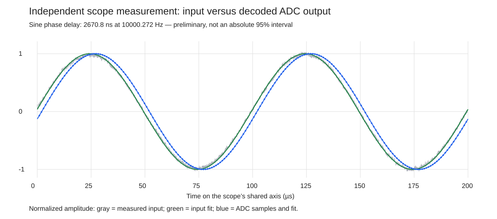
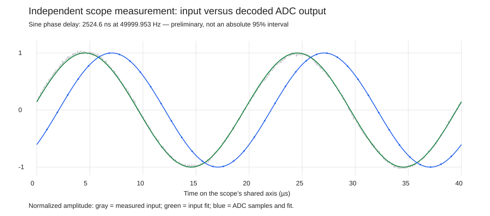

# Measuring ADC delay with a sine wave

Test date: November 11, 2026

## Purpose and result

We fed a sine wave into the ADS127L18 digitizer and used a four-channel oscilloscope to record both the input voltage and the digitizer's output. A Python program decoded the output into samples, reconstructed the sine wave, and measured how far it lagged behind the input.

The measured delay was approximately **2.52 to 2.73 microseconds over 5–200 kHz**. At 50 kHz, five separate captures gave a mean of **2525.8 ns** and a standard deviation of **0.8 ns**. The roughly 200 ns variation across frequencies is not critical to the intended application. The important result is an independent measurement method that connects the measured input directly to the digitized output.

This test used the ADC outputs before voltage translation. It did not use the P4 timer, GPIO6 switching threshold, or the earlier 2553 ns correction. That earlier value was not subtracted from, added to, or used to fit these measurements.

## What we connected

The Rigol DHO914S signal generator supplied a sine wave through a resistor divider to CH0P. CH0N was grounded. The scope measured the voltage at CH0P, so the analysis used the actual signal reaching the ADC rather than the generator's programmed voltage.

All four scope channels were recorded simultaneously:

| Scope channel | Connection | What it tells us |
| --- | --- | --- |
| CH1 | ADC analog input, CH0P | The input sine wave, measured in volts |
| CH2 | FSYNC | Where each output sample begins |
| CH3 | DCLK | When to read each output bit |
| CH4 | DOUT0 | The bits containing status and the digitized CH0 value |

The P4 and voltage translator were disconnected from these three ADC output signals. The Feather continued to configure and start the ADC. Probe grounds and circuit grounds were connected together.

The ADC produced 1,024,000 samples per second, approximately one every 977 ns. DCLK ran at 32.768 MHz. Each scope channel contained one million points spaced 3.2 ns apart, covering 3.2 ms. This provided about 3276 complete ADC samples per capture. The scope recorded voltages on all four channels; Python interpreted the three digital waveforms afterward.

## Rebuilding the sine wave from digital outputs

The three digital signals work together. DOUT0 alone is just a sequence of high and low voltages. DCLK tells us when to read those voltages, and FSYNC tells us how to divide the resulting bits into samples.

For each complete sample, the program does the following:

1. Finds the rising DCLK edges and reads the levels of FSYNC and DOUT0 at those times.
2. Uses the low-to-high change in FSYNC to identify the beginning of a frame. In this configuration, a frame contains 32 bits: eight status bits followed by a signed 24-bit ADC value, most significant bit first.
3. Assembles the bits into a number. The status byte is checked, and the remaining 24 bits are converted to a signed sample value.
4. Associates that sample value with the measured rising edge of FSYNC that announced it. The timestamp is not the later time when all 32 bits have arrived.

Repeating this process gives a series of pairs:

```text
FSYNC time       ADC value
t0               value0
t1               value1
t2               value2
...              ...
```

Plotting the ADC values against their FSYNC times rebuilds the output sine wave. These values represent the ADC's measurement of the analog input; they are not the logic voltage measured at DOUT0. Conversion from ADC codes to volts is unnecessary for measuring phase because amplitude and vertical offset are fitted separately.

Both the input trace and the reconstructed output use the scope's same time axis. There is no need to match an event in one recording to an event in another recording. There is also no need to synchronize the signal generator with the ADC.

## Measuring the phase shift

The program first estimates the sine frequency from the measured input. It then fits a sine wave to the input voltages and another to the decoded ADC values, using that same frequency for both.

Each fit adjusts three quantities: vertical offset, amplitude, and phase. Phase describes where a wave is in its cycle at a given time. A delayed wave reaches the same part of its cycle later.

The fitted function is:

```text
value(t) = offset + a × sin(2πft) + b × cos(2πft)
phase    = atan2(b, a)
```

Python chooses the coefficients that minimize the sum of the squared differences between the measured values and the fitted curve. This is an ordinary least-squares fit. It uses the entire capture, rather than selecting one noisy peak or crossing.

The phase difference becomes a delay through:

```text
delay in seconds = (input phase − output phase) / (2π × frequency)
delay in ns      = delay in seconds × 1,000,000,000
```

For example, at 50 kHz one cycle lasts 20 microseconds. The output lags by about 45.4 degrees, or 12.6% of a cycle. That corresponds to approximately 2.525 microseconds.

### The measured waves

The graphs below show two cycles from representative captures. Gray shows the measured input, averaged in groups of 16 scope points for display only. Green is its fitted sine wave. Blue dots are decoded ADC samples, and the blue line is their fitted sine wave. Amplitudes and offsets are normalized so the timing difference is easy to see. Neither curve has been shifted horizontally to make it agree with the other.



At 10 kHz, the roughly 2.67 microsecond delay is a small fraction of the 100 microsecond period.



At 50 kHz, approximately the same delay occupies a much larger fraction of the cycle, making the displacement easier to see.

### Why the result can be finer than the sample interval

The ADC still supplies only one value every 977 ns. We do not create additional ADC measurements between those samples. Instead, each measured value constrains where the sine wave can lie. Moving the fitted wave slightly in time changes its predicted values at many sample positions. Thousands of samples collectively determine its phase more finely than the spacing between individual samples.

This works because the test signal is a repeating sine wave. It does not mean that an arbitrary isolated event can be located with the same precision.

### The whole-cycle ambiguity

A repeating sine wave cannot, by itself, distinguish a delay from that delay plus one or more complete periods. The program initially reports the phase difference within half a cycle in either direction.

At 200 kHz, one period is approximately 5000 ns. The initial result was −2476.1 ns. Adding one period gives **2523.9 ns**, consistent with the neighboring 50 and 100 kHz measurements. The 200 kHz result below uses that choice. The single 200 kHz capture alone does not establish which whole cycle is intended.

## Results

| Input frequency | Separate captures | Mean phase delay |
| --- | ---: | ---: |
| 5 kHz | 1 | 2729.9 ns |
| 10 kHz | 6 | 2640.7 ns |
| 20 kHz | 1 | 2559.4 ns |
| 50 kHz | 5 | 2525.8 ns |
| 100 kHz | 1 | 2523.1 ns |
| 200 kHz | 1 | 2523.9 ns, with one period added |

The sixth 10 kHz capture was a return measurement after the initial 50 kHz group. It gave 2628.1 ns, within the range of the first five 10 kHz captures. The frequency dependence therefore was not simply eliminated by returning to the earlier setting. Its physical cause has not been established, and the frequency groups were not collected in randomized order.

The results approach approximately 2524 ns at the higher frequencies. We retain the individual frequency results rather than average them into a single supposedly exact correction. The measurements describe **phase delay at each test frequency**, not a direct measurement of broadband group delay.

## Checks and uncertainty

All included captures decoded with valid frame lengths and status values. Repeating the decoding with digital thresholds of 0.7, 0.9, and 1.1 V produced identical sample codes. The resulting delay changed by approximately 0.9 ns across those thresholds, reflecting the small change in the assigned FSYNC crossing times.

We also divided each capture into eight disjoint time segments and repeated the fits. Those fits used the frequency estimated from the complete capture. They show how the estimate varies within a recording; we did not count them as eight independent experimental repeats.

For the original groups of five separate captures:

| Frequency | Mean delay | Standard deviation between captures | 95% confidence interval for the mean |
| --- | ---: | ---: | ---: |
| 10 kHz | 2643.2 ns | 25.7 ns | 2611.4–2675.1 ns |
| 50 kHz | 2525.8 ns | 0.8 ns | 2524.8–2526.8 ns |

These are Student t intervals calculated from five whole-capture estimates, assuming independent repeats with approximately normally distributed errors. The 10 kHz row excludes the later return capture so it describes the original five-capture group.

**These intervals describe repeatability, not a complete 95% bound on absolute accuracy.** Probe and channel timing differences, loading, and interference in the analog measurement can shift the result without making repeated results scatter. The measured input trace contains appreciable high-frequency noise; fitting a sine reduces its influence, but does not establish that all resulting bias is zero.

The method independently places the delay near 2.5 microseconds and makes the connection between the input and each decoded sample explicit. It supports the general scale of the earlier 2553 ns calibration, while avoiding its GPIO switching-threshold measurement. It does not include the voltage translator or establish a universal nanosecond-accurate correction for every waveform.

## Code and retained evidence

- [analyzeScopeDelay.py](../espP4/test/analyzeScopeDelay.py): `decode` rebuilds samples and assigns FSYNC times; `fitFrequency` estimates frequency; `fitSine` fits each wave; `phaseDelay` converts the phase difference to nanoseconds.
- [exportScopeWaveforms.py](../espP4/test/exportScopeWaveforms.py): downloads the stopped scope record for each channel.
- [Frequency means and capture locations](../captures/scope/delayFrequencyRegression.json): identifies every capture included in the results table. The descriptive regression is not needed for the delay measurement itself.
- [Repeated-capture statistics](../captures/scope/delayFrequencyComparison.json): individual results and confidence intervals for the original 10 and 50 kHz groups.
- [200 kHz whole-cycle adjustment](../captures/scope/20261111-212030-249050/phaseUnwrap.json).

Each capture directory retains the exported waveforms and its manifest, decoded samples, analysis results, and comparison graph. The two graphs embedded here are copies of the corresponding capture graphs, retained with the documentation.
