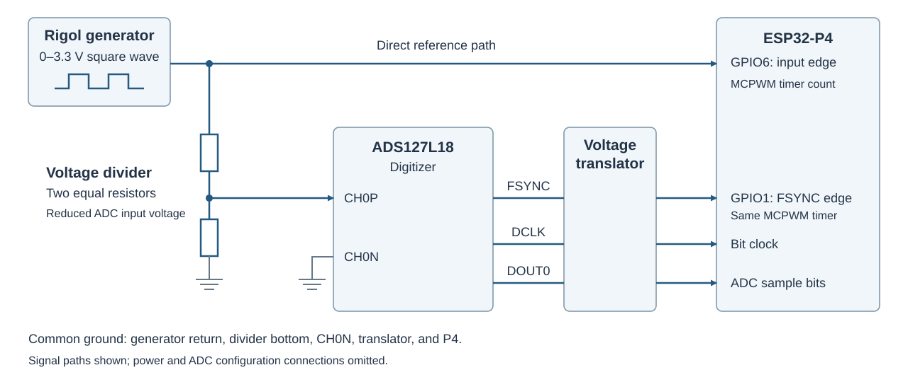
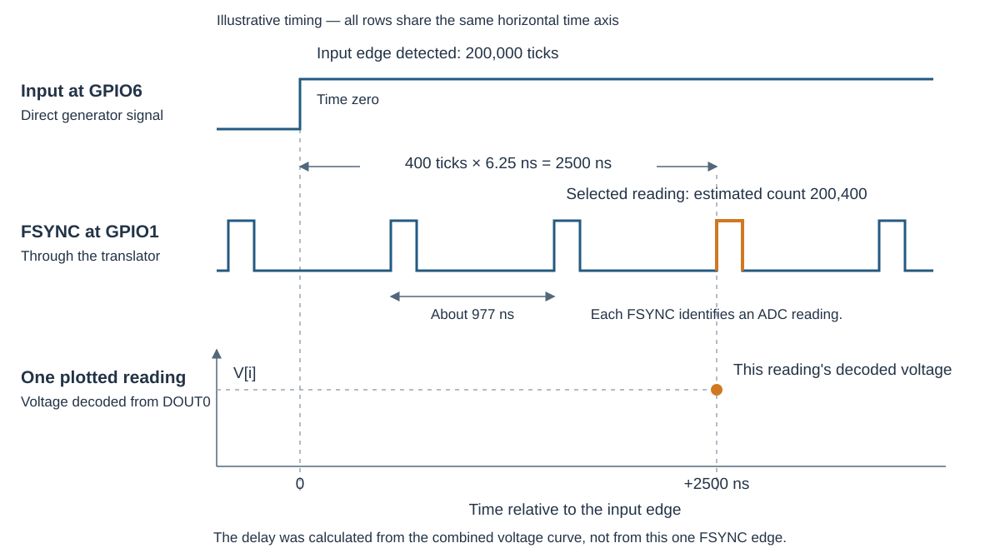
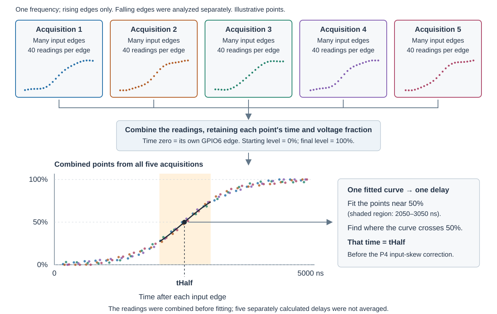
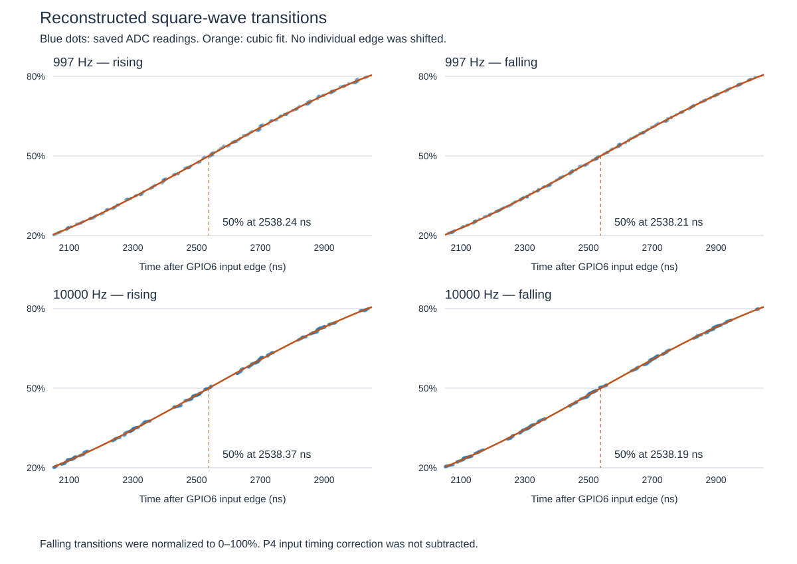

# Measuring digitizer delay with a square wave

Test date: 5 November 2026  
Saved-data analysis using a fitted measured curve: 12 November 2026

## Purpose and result

This document describes the method and results of the first calibration of signal delay through the ADS127L18 digitizer and its output voltage translator. A square wave was supplied to the input. The 160 MHz MCPWM timer of the ESP32-P4 was used to measure rising-edge delays.

Measured delays of approximately **2535 ns** were obtained at both 997 Hz and 10 kHz. Five captures at each frequency were included.  A complete 95% absolute uncertainty bound was not established.

## Connections and Input

A square wave was supplied by a Rigol 914S signal generator, with 50% duty cycle and nominal levels of 0 and 3.3 V. The output was connected directly to GPIO6 and, through a resistor divider, to the digitizer input:



| Path | Connection | Purpose |
| --- | --- | --- |
| Direct input | Generator to P4 GPIO6 | The time of each input transition was recorded. |
| Digitizer input | Generator through a voltage divider to CH0P; CH0N grounded | The same transition was digitized at a reduced voltage. |
| Digitizer output | FSYNC, DCLK, and DOUT0 through the voltage translator to the P4 | ADC values were decoded, and their associated FSYNC pulses were identified. |

FSYNC was connected to GPIO1. During setup, approximately 0.13 V and 1.46 V were observed at the loaded digitizer input. The initial and final levels were subsequently estimated separately for every recorded transition rather than assumed from the generator setting.

## Samples and capture

ADC samples were produced continuously at 1,024,000 per second, approximately 977 ns apart, and retained in P4 memory. The rises and falls of the square-wave input were detected separately by MCPWM hardware at GPIO6. For each detected edge, the 160 MHz timer count and the direction of the change (rising or falling) were saved. Each timer tick represented 6.25 ns. The edge time was recorded by hardware, independently of when software subsequently read it.

The same timer was used to record FSYNC edges at GPIO1, so input-edge times and ADC output times could be compared. After acquisition was stopped, each selected signal input edge was located within the sequence of retained ADC readings using the numbered FSYNC timing references. Forty consecutive readings were then selected, beginning approximately 12 microseconds before that edge and extending beyond the digitized voltage change. Thus, the input edges were identified from GPIO6, not inferred from changes in the ADC readings.

These groups of forty readings, their input-edge timer counts and directions, and the numbered FSYNC timing references were exported to the PC. The delay calculations were performed in Python from these saved records.

Each ADC reading was assigned a time relative to its input edge, using the FSYNC timing references. Readings from many edges were then combined to show how the digitized voltage rose or fell over time after the input changed. A separate curve was fitted for each frequency and direction, using readings five captures at each frequency. The delay was calculated as the time from detection of the input edge to the point where the fitted output curve had completed half of its voltage change.

## Assigning a time to each ADC reading

Two quantities were needed for each of the forty readings: its voltage and its time relative to the input edge. The voltage was recovered from the ADC's digital output using the same bit and frame interpretation described in the [sine-wave test](SINE-PHASE-DELAY-TEST.md). In this test, however, the digital signals were received and decoded by the P4; in the sine-wave test, saved oscilloscope waveforms were decoded in Python. The resulting ADC values were converted to voltages on the PC.

The time calculation was separate from decoding the voltage. Each reading was identified by its sample number, and its output time was associated with that sample's FSYNC rising edge at GPIO1. A timer count was not saved for every sample. Instead, selected FSYNC timer counts and their sample numbers were saved as timing references. The average spacing between samples was calculated from the first and last references:

```text
ticksPerSample = (lastTicks − firstTicks) / (lastSample − firstSample)
```

Starting from the first reference, the timer count for each reading was estimated from its sample number and this measured spacing. The saved GPIO6 input-edge count was then subtracted, and the difference was converted to nanoseconds:

```text
relativeTicks = (i − firstSample) × ticksPerSample
               − (inputEdgeTicks − firstTicks)

t[i] = relativeTicks × 6.25 ns
```

For example, suppose a reading's FSYNC time was estimated as timer count 200,400, and the input edge had been recorded at count 200,000. That reading was placed at **400 × 6.25 = 2500 ns after the input edge**. Its decoded voltage supplied the vertical coordinate; this time supplied the horizontal coordinate of a point on the reconstructed curve.



The input edge did not have to coincide with an FSYNC edge. FSYNC pulses continued approximately 977 ns apart; the selected reading in this example was associated with one of several pulses after the input edge. Its position on the time axis was established by the timer counts. Its voltage was needed to establish where it fell within the output's rise.

Zero on the time axis was therefore set by detection of the input edge at GPIO6. Readings were placed before or after zero according to their associated FSYNC times, not according to their voltages. The delay was subsequently calculated from the combined voltage-versus-time curve.

Counter wraparound was accounted for when timer counts were subtracted. Intermediate FSYNC references were checked against the calculated sample spacing, and only input edges within the first-to-last reference interval were accepted.

## Reconstructing the measured transition

For each rising or falling edge detected at GPIO6, forty consecutive ADC readings were selected around it:

- **First eight:** before the digitized voltage began changing; averaged to estimate the starting voltage.
- **Middle 24:** included the voltage change.
- **Last eight:** after the digitized voltage settled; averaged to estimate the final voltage.

Each reading was then expressed as a fraction of the transition:

```text
fraction[i] = (voltage[i] − vBefore) / (vAfter − vBefore)
```

The initial level was thereby represented by 0%, and the final level by 100%. 

The readings from all five captures at each frequency were combined. Each reading retained its time relative to its own GPIO6 input edge. No individual transition was shifted horizontally to improve agreement.

Five acquisitions were performed automatically by one execution of the test script at each frequency. The following numbers of input edges were analyzed:

| Acquisition | 997 Hz rising edges | 997 Hz falling edges | 10 kHz rising edges | 10 kHz falling edges |
| --- | ---: | ---: | ---: | ---: |
| 1 | 35 | 36 | 64 | 64 |
| 2 | 34 | 35 | 64 | 64 |
| 3 | 35 | 35 | 64 | 64 |
| 4 | 36 | 36 | 64 | 64 |
| 5 | 36 | 36 | 64 | 64 |
| **Total** | **176** | **178** | **320** | **320** |

Forty readings were contributed by each edge. For rising edges, **176 × 40 = 7,040 points** were combined at 997 Hz, and **320 × 40 = 12,800 points** at 10 kHz. For falling edges, 7,120 and 12,800 points were combined, respectively. These points described the whole voltage change; only points near its halfway level were used in the final curve fit.

The combination of readings into one delay estimate was illustrated below for rising edges at one frequency. A separate calculation was performed for falling edges.



Because the input generator and ADC sampling clock were not synchronized, different portions of the transition were sampled on successive edges. By combining these readings, the gaps between the readings of any single edge were filled with actual measurements from other edges.

## Calculating delay from the fitted curve

The **halfway crossing** was defined as the time when the fitted output curve reached halfway between its starting and final voltage levels. For example, if the voltage rose from 0.2 V to 1.4 V, the halfway level was 0.8 V. On the normalized curve, that level was represented by 50%. For a fall from 1.4 V to 0.2 V, the same halfway level of 0.8 V was obtained.

The time at which the fitted curve crossed that level was called `tHalf`. Because time zero had been set by the input edge at GPIO6, a crossing at +2538 ns gave a measured delay of 2538 ns before the P4 input correction. Halfway referred to the voltage change, not to the middle of the forty readings or the duration of the capture. An actual ADC reading at exactly 50% was not required; the crossing time was calculated from the fitted curve.

A smooth curve was fitted to the combined readings near 50%. A cubic polynomial was used: a curve with constant, linear, squared, and cubed terms. Its coefficients were calculated by least squares, minimizing the sum of squared differences between measured and fitted voltage fractions. Each selected reading was given equal weight.

Readings between 2050 and 3050 ns after the GPIO6 edge were selected. This interval surrounded the crossing found in the earlier analysis. Time was scaled for the calculation:

```text
x = (t − 2550 ns) / 1000 ns

fitted fraction = 0.5 + a0 + a1 × x + a2 × x² + a3 × x³
```

The halfway crossing was obtained by solving:

```text
a0 + a1 × x + a2 × x² + a3 × x³ = 0

tHalf = 2550 ns + x × 1000 ns
```

Exactly one crossing within the fitted interval was required. Because each input edge had already been assigned time zero, `tHalf` was the measured delay before correction for the difference between P4 inputs. The value 2550 ns was used only to center the fitting interval and scale the arithmetic; the crossing was determined by the measured readings.



The saved readings were shown as blue dots, and the fitted curves as orange lines. The uncorrected halfway crossings were marked. Only the neighborhood of the crossing was plotted. The input voltage waveform was not represented by these curves.

### Why delay could be estimated more finely than 977 ns

Consecutive readings of any one transition were separated by approximately 977 ns. However, the readings from different transitions occurred at different positions relative to their input edges. Those positions were determined from the P4 timer, with 6.25 ns ticks, and the numbered FSYNC references.

Near the halfway crossing, the largest gap between the combined measurement times was approximately 22 ns at 997 Hz and 79 ns at 10 kHz. The transition was therefore described by substantially more measured points than were available from a single edge. Its halfway crossing was estimated from a curve fitted to those points, rather than from a straight line between just two readings.

This reconstruction depended on a repeatable transition shape. Noise and changes between transitions were reflected in the scatter of the points. Finer resolution than 977 ns was obtained, but an absolute accuracy bound was not established by the density of the points alone.

## Results

The combined-curve crossings were obtained as follows. The transition counts described the saved edges contributing to each group; only readings inside the fitting interval were used for the local fit.

| Input frequency | Transition | Number of transitions | Fitted halfway crossing, before P4 input correction |
| --- | --- | ---: | ---: |
| 997 Hz | Rising | 176 | 2538.24 ns |
| 997 Hz | Falling | 178 | 2538.21 ns |
| 10 kHz | Rising | 320 | 2538.37 ns |
| 10 kHz | Falling | 320 | 2538.19 ns |

In a separate test, the same rising signal was supplied to GPIO1 and GPIO6. GPIO1 was recorded approximately 3.04 ns later than GPIO6. This difference was subtracted from the rising-edge results:

```text
corrected delay = fitted halfway crossing − 3.04 ns
```

| Input frequency | Corrected rising-edge delay |
| --- | ---: |
| 997 Hz | 2535.20 ns |
| 10 kHz | 2535.33 ns |

Thus, a rising-edge delay of approximately **2535 ns** was obtained at both frequencies. Extra decimal places were retained to show the calculations, not to claim accuracy to hundredths of a nanosecond. The rising-edge correction was not applied to the falling-edge results.

The input-to-output path, including the FSYNC voltage translator, was measured. A chip-only ADC delay was not isolated. The existing firmware correction was not changed by this reanalysis.

## Checks and uncertainty

The saved captures were checked for correct sample-to-FSYNC association, acceptable ADC status bits, consecutive alternating input edges, and input frequency consistent with the generator setting. Settled initial and final levels and a unique halfway crossing were required for each saved transition.

The dependence on the fitted curve was examined by using quadratic, cubic, and fourth-degree polynomials, with fitting windows of ±350, ±500, ±700, and ±900 ns around 2550 ns. Uncorrected crossings across all four groups and these choices ranged from approximately **2533 to 2540 ns**. A sensitivity of a few nanoseconds was indicated; this range was not a 95% confidence interval.

The cubic fit was also repeated separately for each capture. Uncorrected rising-edge crossings ranged from 2536.35 to 2541.19 ns at 997 Hz and from 2535.24 to 2541.45 ns at 10 kHz. These ranges described variation between the five captures at each frequency.

Three limitations were retained:

- **A fast input transition was assumed.** The GPIO6 rising threshold had been measured at approximately 1.765 V, with a sample standard deviation of 0.025 V. However, the input edge waveform during the original calibration was not recorded. Its rise time was assumed negligible compared with the digitized transition, so no additional threshold-to-input-midpoint correction was applied.
- **The measured output curve was fitted, not known exactly.** Curvature was represented using many measured points, but some dependence on the fitting interval and curve choice remained. The applicability of the 3.04 ns P4 input correction also depended on the edge shapes used in the separate input comparison.
- **A complete absolute uncertainty bound was not established.** Capture-to-capture variation and fit sensitivity were examined. Input-path differences, timer resolution, and sample-time assignment also contributed uncertainty and were not fully quantified by those checks.

The result was tied specifically to the halfway point of the digitized square-wave transition. In the separate sine-wave test, delay was defined by the fitted phase shift; identical results from the two definitions were not assumed.

## Code and retained evidence

- [fitPulseTransitionCurve.py](../espP4/test/fitPulseTransitionCurve.py): normalized readings were combined, local curves were fitted, and halfway crossings and sensitivity checks were calculated.
- [Curve-fitting results](../captures/pulse-delay/transitionCurveComparison.json): combined fits, individual capture fits, measurement coverage, and alternative curve/window results were retained. Values in this file were recorded before the P4 input correction.
- [pulseDelayReport.py](../espP4/test/pulseDelayReport.py): sample times were assigned by `analyze`; transition levels and normalized readings were obtained by `measureEdge`. The original analysis code and saved captures were not changed.
- [997 Hz capture results](../captures/pulse-delay/20261105-153442/result.json) and [10 kHz capture results](../captures/pulse-delay/20261105-170932/result.json): the five trials, individual ADC transitions, and timing references were retained for each frequency.
- [Sine-wave delay measurement](SINE-PHASE-DELAY-TEST.md): the independent phase-shift method and its results were documented separately.

## Relationship to established measurement practice

The reconstruction used the principle of **equivalent-time sampling**: readings from repeated occurrences of a waveform were combined according to their times relative to a common reference edge. This established technique was described by [Tektronix](https://www.tek.com/en/documents/application-note/real-time-versus-equivalent-time-sampling). A 50% voltage crossing was also used as a conventional timing reference in [Keysight delay measurements](https://helpfiles.keysight.com/csg/N1930xB/VNACalAndMeas/Delay_Measurements.htm).

These principles were adapted to the P4 and digitizer. The forty-reading windows, five acquisitions, and local cubic fit were implementation choices. An absolute uncertainty bound for this implementation was not established by those precedents alone.
